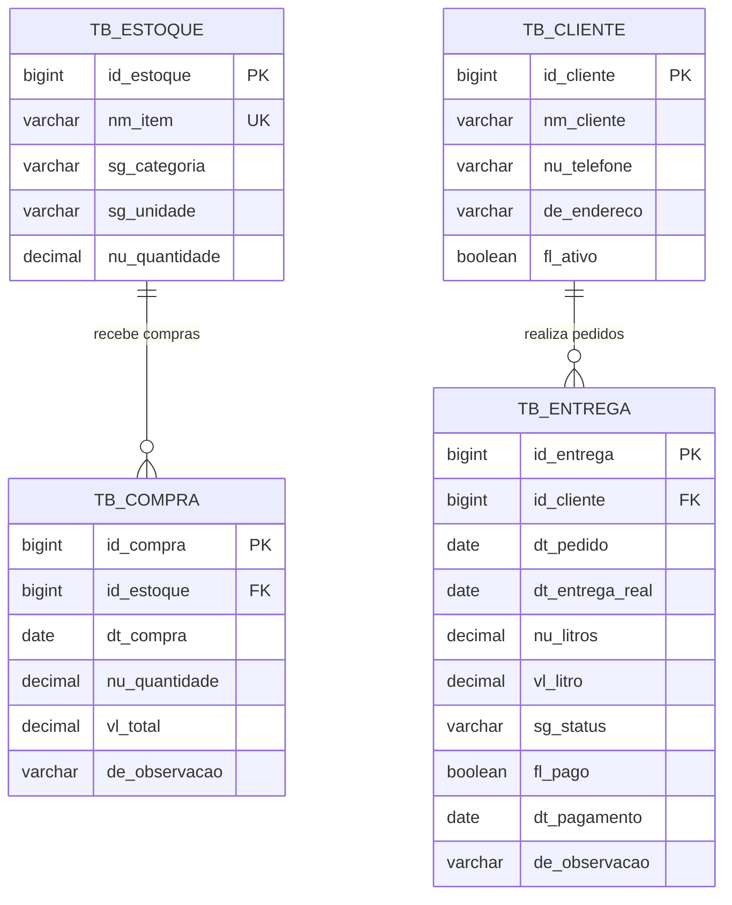

# Modelo relacional atual

## 1. Visão lógica

`tb_animal` e `tb_producao` não possuem relacionamentos por FK na estrutura apresentada.

## 2. Entidades sem relacionamento físico

- `tb_animal`: cadastro independente de animais.
- `tb_producao`: registro diário agregado da produção.

A tabela de produção possui unicidade em `dt_producao`, indicando no máximo um registro por data.

## 3. Interpretação dos relacionamentos

- Um item de estoque pode aparecer em várias compras.
- Cada compra referencia um item de estoque.
- Um cliente pode possuir vários registros de entrega.
- Cada registro de entrega referencia um cliente.

## 4. Limites do modelo atual

- Não existe tabela de itens de pedido; o registro é feito diretamente em `tb_entrega`.
- Não há separação física entre quantidade pedida e quantidade efetivamente entregue.
- Não há entidade de recebimento financeiro independente.
- Não há FK entre animal e produção.
- Não há tabela de fornecedor.
- Não há tabela de movimentação de estoque.
- Não há controle de estoque de leite.

O diagrama representa os relacionamentos físicos confirmados e não propõe relacionamentos adicionais.
